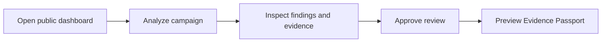
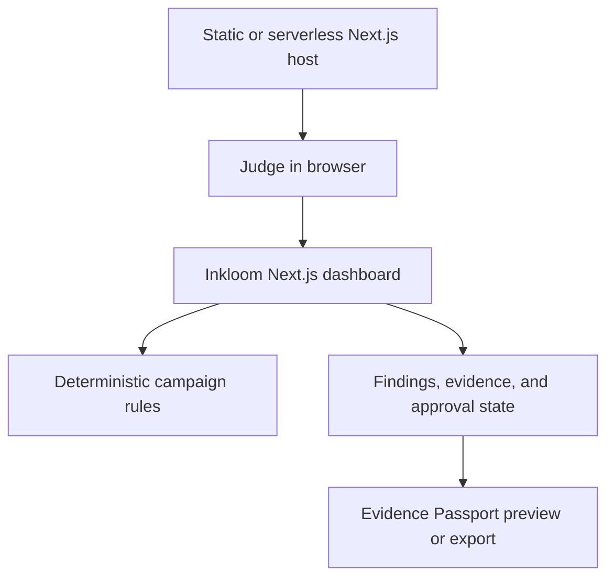

# Inkloom Architecture Brief

## For judges and implementation partners

Inkloom is a public content-governance workspace: a judge enters or reviews campaign content, inspects the evidence behind flagged claims, approves a human decision, and receives a transparent Evidence Passport.

## What judges can expect

The demo does not require signup, login, a database, or setup. The Next.js page runs the analysis experience and stores the session's campaign and approval state in the browser.

## System boundary

This is deliberately a thin public demo architecture. It proves the complete product journey without building infrastructure that judges do not need.

## Why this boundary wins for the demo

- It starts from the existing dashboard instead of replacing working UI.
- It makes the core story testable in one browser session.
- It creates no account or data-retention obligation.
- It separates deployment infrastructure from product behavior, keeping the value path portable.
- It gives later stories a clear place to add custom input and real passport export.

## Architecture rules

1. The public URL is the entry point.
2. Analysis functions are deterministic and local.
3. A passport is available only after review approval.
4. One campaign snapshot supplies the campaign, findings, evidence, corrections, and approval outcome.
5. Custom campaign text stays in the browser and is rendered as text, never HTML.
6. No judge-facing copy describes missing persistence, Supabase, or a future feature.
7. The public release is checked with lint, production build, and the complete browser journey.

## Implementation shape

| Area | Home |
| --- | --- |
| Application shell and public metadata | `src/app/layout.tsx` |
| Campaign dashboard and review journey | `src/app/page.tsx` |
| Shared visual language | `src/app/globals.css` |
| Public output | Next.js production build |

## Trade-offs

Browser-local state is fast, portable, and sufficient for judging, but it resets on reload. The architecture intentionally defers authentication and multi-user persistence until the product has a real tenant boundary. Adding a backend now would add setup and failure risk without strengthening the hackathon story.
