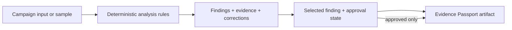
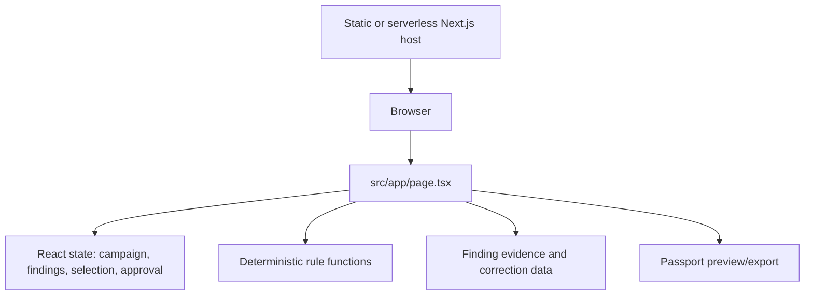

# Architecture Spine — Judge-ready public demo

## Design Paradigm

**Client-side review state machine.** The browser owns the demo journey and the data it derives:



Next.js renders the presentation and route shell; React state mutates the review journey; the analysis rules and evidence snapshot remain local.

## Invariants & Rules

### AD-1 — The public demo has no required account or server dependency

- **Binds:** R1, R5
- **Prevents:** Login, API, database, or infrastructure work becoming a prerequisite for judging.
- **Rule:** The complete demo path must run from a deployed Next.js page with browser state only.

### AD-2 — Analysis is deterministic and browser-local for the demo

- **Binds:** R2, R3
- **Prevents:** Claims that imply unseen AI, backend inference, or persistent records.
- **Rule:** Seeded analysis and custom campaign matching remain deterministic functions of the current campaign content and demo rules. Clear loading or error language is preferable to fabricated backend work.

### AD-3 — Approval is a real gate for passport creation

- **Binds:** R3, R4
- **Prevents:** Passport preview or export being available from an unreviewed campaign.
- **Rule:** Browser state transitions as `pending -> analyzed -> approved`; approval is not exposed before analysis, and passport actions may read only the approved snapshot containing the run ID and reviewed finding IDs.

### AD-4 — One campaign snapshot owns all review evidence

- **Binds:** R2, R3, R4
- **Prevents:** The campaign text, finding list, evidence, correction, approval state, and passport drifting from one another.
- **Rule:** A review action derives its findings and passport fields from one current client-side campaign snapshot; re-running analysis replaces stale approval state and invalidates old findings.

### AD-5 — The campaign snapshot and passport use stable data contracts

- **Binds:** R2, R3, R4
- **Prevents:** Independent input, analysis, approval, preview, and export implementations producing incompatible records.
- **Rule:** A versioned snapshot contains `{schemaVersion, runId, campaignTitle, campaignText, analyzedAt, status, findings, selectedFindingId, approval}`. A passport is derived only from an approved snapshot and carries the campaign summary, finding ID/title/severity/claim/evidence/recommendation fields, approval outcome, approval timestamp, and architecture rule/evidence-library version.

### AD-6 — Public quality is verified as a release gate

- **Binds:** R1, R5
- **Prevents:** A public URL passing compilation but failing the judge workflow or exposing demo-only limitations.
- **Rule:** Before release, run lint, production build, and a browser smoke check that covers sample analysis, finding review, approval, Passport Preview, custom-content empty input handling, and public no-login access. Remove Supabase, persistent-record, and coming-next judge-facing language.

### AD-7 — Custom campaign text is treated as untrusted browser input

- **Binds:** R2
- **Prevents:** Empty, oversized, executable, or markup-bearing campaign text destabilizing the public demo.
- **Rule:** Render campaign text as React text, not HTML; reject empty submissions with an inline input-required state and place practical length limits in the client contract. Do not send campaign text to analytics, telemetry, or external services.

## Consistency Conventions

| Concern | Convention |
| --- | --- |
| Page state | Keep the public tracer in `src/app/page.tsx`; extract a helper or component only when it is reused or becomes too large to review safely. |
| Approval copy | Use positive operational language: `Approved`, `Review approved`, and `Passport ready`; do not show Supabase, persistence, or demo limitations in the judge flow. |
| Findings | Each finding has an ID, title, category, severity, status, claim, explanation, evidence, and recommendation. |
| IDs and formats | Finding IDs are stable within one analysis run; passport dates and generated identifiers use client-readable ISO-like values. |
| Errors and empty states | Do not preserve stale findings after analysis failure or empty results; render an explicit no-findings or input-required state. |
| Configuration | Next.js metadata and public copy live at the framework/page boundary; no environment secret is needed. |
| Snapshot state | Use one React reducer or an equivalent atomic snapshot transition; independent booleans must not own campaign status. |
| Passport export | Both preview and download consume the same serialized approved snapshot; filenames use a safe campaign slug and schema version. |
| Timestamp format | Store browser-visible ISO timestamps from the snapshot; do not generate export-time approval data. |
| Accessibility | Analysis, finding selection, approval, preview, and empty/error states remain keyboard reachable and screen-reader labeled. |

## Stack

| Name | Version |
| --- | --- |
| Next.js | 16.4.5 |
| React | 19.3.0 |
| TypeScript | 5.x |
| Tailwind CSS | 4.x |
| Lucide React | 1.47.0 |
| ESLint | 9.x |

## Structural Seed

```text
src/
  app/
    layout.tsx       # Public metadata and application shell
    page.tsx         # Campaign state machine and dashboard UI
    globals.css      # Shared Tailwind/global styles
```



## Capability → Architecture Map

| Capability / Area | Lives in | Governed by |
| --- | --- | --- |
| Public page access and metadata | `src/app/layout.tsx`, Next.js route | AD-1 |
| Campaign analysis and custom content | Browser state and rule functions in `src/app/page.tsx` | AD-2 |
| Evidence review and correction | Finding model and selected-finding panel | AD-4 |
| Approval | Review workflow state in `src/app/page.tsx` | AD-3, AD-4 |
| Evidence Passport preview/export | Passport surface derived from approved snapshot | AD-3, AD-4, AD-5 |
| Public deployment and verification | Static/serverless compatible Next.js production output | AD-1, AD-6 |
| Custom untrusted campaign text | Browser input and deterministic analysis state | AD-2, AD-7 |

## Deferred

- Hosting provider and public URL.
- Persistent records and real reviewer identity; browser-local state remains the hackathon implementation.
- AI-backed analysis, authenticated workspaces, and external evidence integrations.
- Multi-user conflict handling and production audit controls.
- Hosting provider selection remains open until deployment.
